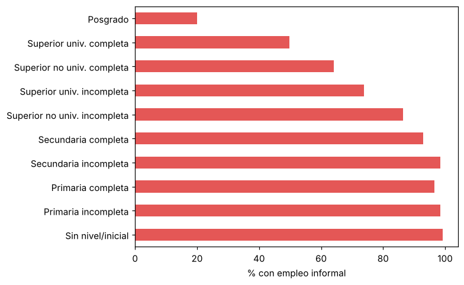
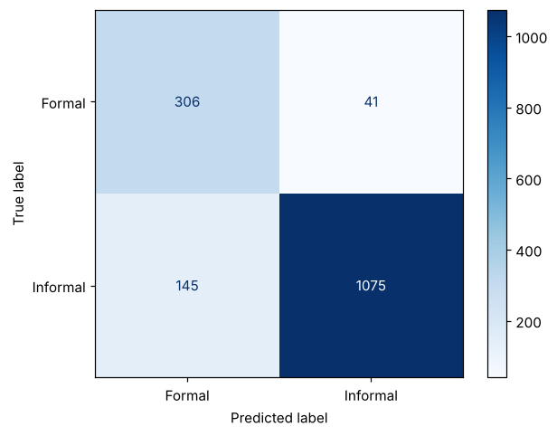

# Empleo informal en Puno: ¿quién tiene un empleo informal?
## Producto 1 · Informe técnico de modelado supervisado

**Equipo:** Abel Condori Carcasi
**Repositorio:** https://github.com/abelcdri/Trab-Final-UNAJ

---

## 1. Problema y contexto

El empleo informal deja a los trabajadores sin contrato, sin seguro de salud y sin aportes a una pensión. En la muestra de Puno que analizamos, **casi 8 de cada 10 personas ocupadas (78 %) tienen un empleo informal**. Saber quiénes son, a partir de rasgos de la persona y de su trabajo, ayuda a **focalizar programas de formalización y protección social**.

**Pregunta:** dadas las características de una persona ocupada en Puno, ¿tiene un empleo informal?

Es un problema de **clasificación binaria** (informal / formal).

## 2. Datos

**Fuente:** Encuesta Permanente de Empleo Nacional (EPEN) 2025, base anual del departamento de Puno (INEI, 2026), con su diccionario de datos.
**Tamaño:** 18 264 registros de personas. Nos quedamos con las **personas ocupadas** que tienen el indicador de informalidad del INEI (`Informal_P`): **7 836 observaciones de 5 479 personas distintas**, en 3 532 hogares.
**Variable objetivo:** `informal` (1 = empleo informal), presente en el **77,8 %** de los casos (6 100 informales y 1 736 formales).

> Nota: `Informal_P` no figura en el diccionario. Por lo cual se hace una Interpretacion 1 = informal y 2 = formal porque **todos** los trabajadores cuya empresa no está registrada en SUNAT tienen el código 1.

Usamos **13 variables**: edad, horas trabajadas, ingreso mensual de la ocupación principal, número de limitaciones, años de estudio, sexo, zona (urbana o rural), nivel educativo, lengua materna, autoidentificación étnica, ocupación (gran grupo CIUO), rama de actividad (CIIU agrupada) y si quería trabajar más horas.

**La EPEN es un panel:** 2 357 personas aparecen dos veces en el año. Si una misma persona queda en entrenamiento y en test, el modelo la "reconoce" y las métricas salen infladas. Por eso **toda la validación se hace por persona**.

**Hallazgos del análisis exploratorio** (`notebooks/01_eda.ipynb`):

1. **Las clases están desbalanceadas:** 78 % es informal. Por eso no usamos la accuracy.
2. **La educación es la señal más fuerte:** la informalidad baja de **99 %** sin nivel educativo a **20 %** con posgrado. Con secundaria completa o menos es de 93 % o más.
3. **La zona pesa mucho:** **98 %** en el área rural contra **74 %** en la urbana. Con lengua materna quechua o aimara es de 86 % y 84 %, contra 68 % en castellano.
4. **La edad forma una "U":** 95 % entre los 14 y 24 años, 71 % entre los 45 y 54, y 88 % a partir de los 65.
5. **La ocupación y la rama importan:** la agricultura es 100 % informal; los profesionales, 19 %; el sector educación, 13 %.
6. **El ingreso separa a los dos grupos:** la mediana es de S/ 2 700 en el empleo formal y de S/ 450 en el informal.

## 3. Métrica de éxito

**Métrica principal: exactitud balanceada** (promedio del recall de informales y del recall de formales).

**Justificación:** con 78 % de informales, un modelo que dice "todos son informales" detecta al 100 % de los informales sin aprender nada. Medir solo el recall de informales lo premiaría. La exactitud balanceada lo deja en 0,50. Además, ambos errores tienen costo: no detectar a un informal lo deja fuera de un programa de apoyo, y señalar a un formal desperdicia recursos. Reportamos también el **ROC-AUC** y el recall de cada grupo.

## 4. Preprocesamiento

| Tipo | Columnas | Tratamiento |
|---|---|---|
| Numéricas | edad, horas, log(1 + ingreso), limitaciones, años de estudio | Imputar con la mediana + escalar |
| Categóricas | sexo, zona, educación, lengua, etnia, ocupación, rama, quiere más horas | Imputar con la más frecuente + one-hot |

**Cómo evitamos la fuga de datos:**
- Todo el preprocesamiento va **dentro de un `Pipeline`** con `ColumnTransformer`, así que se aprende solo con los datos de entrenamiento de cada fold.
- **Excluimos las variables con las que el INEI define la informalidad:** registro en SUNAT, libros contables, tipo de trabajador, tamaño de la empresa, seguro de salud y pensiones. Los trabajadores de empresas no registradas son 100 % informales por construcción, y usar esa variable haría que el modelo solo "descubra" la regla.
- Separamos un **20 % de test** (1 567 filas) al inicio y lo usamos **una sola vez**, sin repartir a ninguna persona entre entrenamiento (6 269 filas) y test.

## 5. Modelos comparados

| Modelo | Por qué lo incluimos |
|---|---|
| Baseline (clase mayoritaria) | Punto de referencia mínimo |
| Regresión logística (L2) | Modelo lineal regularizado, simple e interpretable |
| k-NN (k = 15) | Modelo basado en distancias |
| Random Forest | Ensamble de bagging |
| Gradient boosting (`HistGradientBoostingClassifier`) | Ensamble de boosting |

Los modelos usan `class_weight="balanced"` cuando lo permiten.
**Validación:** validación cruzada de 5 folds **estratificada y agrupada por persona** (`StratifiedGroupKFold`) sobre el 80 % de entrenamiento.

## 6. Resultados

| Modelo | Exactitud balanceada | ROC-AUC | Recall informales | Recall formales |
|---|---|---|---|---|
| Baseline | 0,500 ± 0,000 | 0,500 ± 0,000 | 1,000 | 0,000 |
| k-NN (k = 15) | 0,827 ± 0,009 | 0,933 ± 0,003 | 0,952 ± 0,006 | 0,701 ± 0,024 |
| Random Forest | 0,869 ± 0,008 | 0,949 ± 0,003 | 0,934 ± 0,005 | 0,804 ± 0,019 |
| Gradient boosting | 0,869 ± 0,007 | 0,948 ± 0,004 | 0,916 ± 0,006 | 0,821 ± 0,014 |
| **Regresión logística (L2)** | **0,870 ± 0,003** | **0,948 ± 0,004** | 0,879 ± 0,008 | 0,862 ± 0,012 |

**Mejor modelo: regresión logística.** Tres modelos quedan empatados en la práctica (las diferencias son menores que la variación entre folds). Elegimos la logística porque tiene la exactitud balanceada más alta con la menor variación, el mejor recall de formales de los tres y es el modelo más simple y explicable. El k-NN es claramente peor, y el baseline detecta al 100 % de los informales pero al 0 % de los formales.

**Resultado en el test:** exactitud balanceada = **0,881** y ROC-AUC = **0,952**, en línea con la validación cruzada.

En lenguaje sencillo: **el modelo identifica correctamente a 88 de cada 100 trabajadores informales y a 88 de cada 100 formales.**

## 7. Conclusiones y próximos pasos

- Un modelo simple ya separa bien el empleo informal del formal usando solo rasgos de la persona y de su ocupación, sin las variables que definen la informalidad.
- Que la logística empate con los ensambles sugiere que la relación entre las variables y la informalidad es bastante directa.
- **Para el Producto 2:** optimizar el boosting para intentar superar a la logística, buscar perfiles de trabajadores con aprendizaje no supervisado, comparar con una red neuronal y revisar si el modelo trata igual a hombres y mujeres, a distintas zonas y a distintas edades.

---

**Referencias**

- Instituto Nacional de Estadística e Informática. (2026). *Encuesta Permanente de Empleo Nacional 2025: base de datos anual, Puno* [Conjunto de datos]. INEI, plataforma de microdatos.
- Instituto Nacional de Estadística e Informática. (2026). *Encuesta Permanente de Empleo Nacional: diccionario de datos (agosto 2026)*. INEI.
- Pedregosa, F., Varoquaux, G., Gramfort, A., Michel, V., Thirion, B., Grisel, O., ... Duchesnay, E. (2011). Scikit-learn: Machine learning in Python. *Journal of Machine Learning Research, 12*, 2825-2830.

