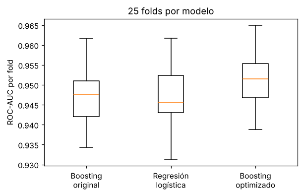
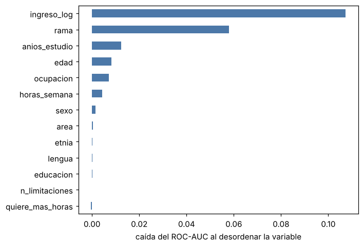

# Empleo informal en Puno con aprendizaje automático
## Producto 2 · Proyecto integrador final

**Autores:** Abel Condori Carcasi
**Repositorio:** https://github.com/abelcdri/Trab-Final-UNAJ 

---

## Resumen

La informalidad laboral deja a los trabajadores sin seguro de salud, pensión ni contrato. Este trabajo construye un modelo que, a partir de rasgos de la persona y de su ocupación, estima si un trabajador ocupado de Puno tiene un empleo informal. Usamos 7 836 observaciones de 5 479 personas de la Encuesta Permanente de Empleo Nacional (EPEN) 2025 del INEI y 13 variables, excluyendo las que definen la informalidad para evitar fuga de datos. Como la encuesta es un panel, toda la validación se hizo por persona. Comparamos cinco modelos con validación cruzada, optimizamos un gradient boosting con búsqueda aleatoria de 30 intentos y lo contrastamos fold a fold con la regresión logística: la supera en 24 de 25 folds, pero por solo 0,004 de ROC-AUC. El modelo final alcanzó una exactitud balanceada de 0,888 y un ROC-AUC de 0,956 en el test. Un análisis con k-means halló dos perfiles de trabajadores con 97 a 98 % de informalidad, y una red neuronal no mejoró los resultados. La revisión de equidad mostró errores más frecuentes en trabajadores formales jóvenes y en mujeres formales, señales que conviene vigilar antes de cualquier uso.

**Palabras clave:** empleo informal, mercado laboral, EPEN, aprendizaje automático, equidad algorítmica.

## 1. Introducción

El empleo informal limita el acceso a la protección social y suele asociarse a menores ingresos. En Puno, la muestra de la EPEN 2025 indica que cerca de 8 de cada 10 personas ocupadas tienen un empleo informal. Estimar quién lo tiene permite **focalizar programas de formalización y apoyo** y entender qué rasgos se asocian con la informalidad.

Este trabajo amplía el Producto 1 con optimización de hiperparámetros, una comparación estadística fold a fold, análisis no supervisado, una red neuronal, interpretación del modelo, revisión de sesgo y una demo funcional.

*Trabajos relacionados:* [completar con 2 o 3 estudios sobre informalidad laboral y aprendizaje automático, citados en APA 7].

## 2. Datos

Usamos la EPEN 2025 del INEI (base anual de Puno, 18 264 registros). Trabajamos con las **personas ocupadas** que tienen el indicador de informalidad `Informal_P`: 7 836 observaciones de 5 479 personas, de las cuales el **77,8 %** tiene empleo informal. Interpretamos 1 = informal y 2 = formal (el indicador no figura en el diccionario; todos los trabajadores de empresas no registradas en SUNAT tienen el código 1).

Empleamos 13 variables: cinco numéricas (edad, horas semanales, log del ingreso mensual, número de limitaciones y años de estudio) y ocho categóricas (sexo, zona, nivel educativo, lengua, etnia, ocupación, rama de actividad y si quería trabajar más horas). **Excluimos** las variables con las que el INEI construye la informalidad (registro en SUNAT, libros contables, tipo de trabajador, tamaño de la empresa, seguro de salud y pensiones). Los principales hallazgos exploratorios están en el Producto 1: la educación, la zona, la ocupación y el ingreso separan con claridad a los dos grupos.

## 3. Método

### 3.1 Preprocesamiento
Pipeline con `ColumnTransformer`: imputación con la mediana y escalado para las numéricas; imputación con la más frecuente y one-hot para las categóricas.

### 3.2 Validación
La EPEN es un panel y 2 357 personas aparecen dos veces. Dividimos 80/20 con `StratifiedGroupKFold` agrupando por persona, de modo que ninguna persona queda en ambos conjuntos (6 269 filas de entrenamiento y 1 567 de test). Usamos validación cruzada de 5 folds para comparar modelos y de **5 folds × 5 repeticiones** para la comparación estadística, siempre agrupando por persona. El test se usó una sola vez, para el modelo ya elegido.

### 3.3 Optimización
Optimizamos un `HistGradientBoostingClassifier` (boosting de la misma familia que LightGBM) con **búsqueda aleatoria de 30 intentos**, usando como objetivo el ROC-AUC en validación cruzada. Los seis hiperparámetros fueron: número de iteraciones, tasa de aprendizaje, máximo de hojas, mínimo de casos por hoja, regularización L2 y proporción de variables por árbol. El desbalance se trató con `class_weight="balanced"`. Los notebooks usan Optuna (TPE) si está instalado; los resultados de este informe se obtuvieron con la búsqueda aleatoria.

## 4. Experimentos y resultados

### 4.1 Comparación de modelos

| Modelo | ROC-AUC (5 folds × 5 repeticiones) |
|---|---|
| Boosting original | 0,947 ± 0,006 |
| Regresión logística (modelo del Producto 1) | 0,947 ± 0,007 |
| **Boosting optimizado** | **0,951 ± 0,006** |
| Red neuronal (MLP, 32 y 16 neuronas) | 0,947 ± 0,005 (5 folds) |

### 4.2 ¿La mejora es real?

| Comparación | Folds ganados | Diferencia media | Wilcoxon |
|---|---|---|---|
| Boosting optimizado vs. boosting original | 25 de 25 | +0,0044 | p < 0,001 |
| Boosting optimizado vs. regresión logística | 24 de 25 | +0,0040 | p < 0,001 |

La optimización mejora claramente al boosting y también supera a la regresión logística, pero la diferencia es **pequeña**: cuatro milésimas de ROC-AUC. Como los 25 folds comparten datos entre sí, el valor p exagera la evidencia. Lo leemos como una **mejora consistente pero modesta**. Elegimos el boosting optimizado como modelo final, porque gana de forma sostenida, y mantenemos la regresión logística como referencia simple.

**Resultado en el test:**

| Modelo | Exactitud balanceada | ROC-AUC | Recall informales | Recall formales |
|---|---|---|---|---|
| **Boosting optimizado (final)** | **0,888** | **0,956** | 0,897 | 0,879 |
| Regresión logística (referencia) | 0,881 | 0,952 | 0,881 | 0,882 |

### 4.3 Análisis no supervisado: perfiles de trabajadores

Con k-means sobre cuatro variables numéricas escaladas (edad, horas, ingreso y años de estudio) y **sin usar la variable objetivo**, probamos k de 2 a 6. La silueta fue casi igual con k = 2 (0,309) y k = 3 (0,303); elegimos **k = 3** porque separa a los informales en dos perfiles distintos.

| Perfil | Trabajadores | Rasgos | Informalidad |
|---|---|---|---|
| Adultos con jornada completa | 4 253 | 42 años; 48 horas semanales; ingreso mediano de S/ 1 500; 14 años de estudio; 7 % rural | 61 % |
| **Jóvenes con jornada parcial** | **1 649** | 30 años; 20 horas semanales; ingreso mediano de S/ 134 | **97 %** |
| **Mayores con poca escolaridad** | **1 934** | 61 años; 5 años de estudio; ingreso mediano de S/ 227; 38 % rural | **98 %** |

El primer perfil concentra a más del 90 % de los trabajadores formales. Los otros dos suman **3 583 trabajadores (46 %)** con casi ninguna formalidad: es un criterio simple y explicable para **focalizar programas de formalización y protección social**, complementario al modelo supervisado.

### 4.4 Red neuronal
Un MLP de dos capas (32 y 16 neuronas, con parada temprana) obtuvo un ROC-AUC de 0,947 ± 0,005 con 5 folds por persona, contra 0,948 del boosting y de la logística. **No supera a los otros modelos**, algo esperable en datos de tabla con pocas variables.

## 5. Interpretación

Según la importancia por permutación en el test, las variables que más pesan son:

1. **Ingreso mensual** (caída de 0,107 en el ROC-AUC al desordenarlo)
2. **Rama de actividad** (0,058)
3. Años de estudio (0,012), edad (0,008), ocupación (0,007) y horas trabajadas (0,004)

Sexo, zona, lengua y etnia casi no pesan por sí solas. El modelo se apoya en **cuánto se gana, en qué rama se trabaja y cuánto se estudió**, lo que coincide con el análisis exploratorio.

**Sensibilidad al ingreso.** El ingreso puede ser en parte *consecuencia* de la informalidad. Sin él, el modelo baja de 0,888 a **0,864** de exactitud balanceada (ROC-AUC de 0,956 a 0,943): pierde algo, pero sigue siendo útil, porque la rama, la ocupación y la educación aportan la mayor parte de la señal.

## 6. Ética y limitaciones

**Equidad.** En el test (1 567 trabajadores) la exactitud balanceada es igual en hombres y mujeres (0,88), pero los errores son distintos:

| Grupo | Recall informales | Recall formales | Formales en el test |
|---|---|---|---|
| Hombres | 0,87 | 0,90 | 217 |
| Mujeres | 0,92 | 0,84 | 130 |
| Lengua castellano | 0,82 | 0,89 | 233 |
| Lengua quechua | 0,94 | 0,85 | 66 |
| 14 a 29 años | 0,89 | 0,74 | 31 |
| 30 a 49 años | 0,87 | 0,88 | 175 |
| 50 años o más | 0,92 | 0,91 | 141 |

- Las **mujeres formales** son clasificadas como informales con más frecuencia (16 %) que los hombres formales (10 %).
- Se le "escapan" más informales de **lengua castellana** (18 %) que quechuas (6 %).
- Los **formales de 14 a 29 años** son el grupo más difícil: el modelo acierta solo en el 74 % de ellos.
- En el área rural la exactitud balanceada es alta (0,93), pero allí solo hay 8 formales en el test, por lo que esa cifra no es confiable.

Varias brechas se apoyan en pocos casos, así que son **señales a vigilar**, no conclusiones firmes. Antes de usar el modelo recomendamos revisar el umbral por grupo, buscar variables que expliquen mejor el empleo formal joven y monitorear estas brechas.

**Uso responsable.** El modelo solo debe usarse para **priorizar programas de apoyo y de formalización**, nunca para negar beneficios ni para sancionar a trabajadores o empresas. Toda decisión debe revisarla una persona.

**Limitaciones.**
- Los datos son de **un solo departamento y un solo año**; el modelo no debe aplicarse a otras regiones sin validarlo.
- No usamos los pesos muestrales: los porcentajes describen la muestra, no la población de Puno.
- Interpretamos el código de `Informal_P` (1 = informal) a partir de los datos, porque no está en el diccionario.
- Los 25 folds repetidos no son independientes y los hiperparámetros se eligieron con los mismos datos de entrenamiento, por lo que la mejora de 0,004 puede estar algo inflada.
- Usamos búsqueda aleatoria en lugar de Optuna y `HistGradientBoosting` en lugar de LightGBM; los resultados pueden variar levemente con otras herramientas.
- La rama y la ocupación se agruparon en categorías amplias, lo que pierde detalle.

## 7. Conclusiones

Un modelo de boosting optimizado distingue el empleo informal del formal en Puno con una exactitud balanceada de 0,888 y un ROC-AUC de 0,956, usando solo rasgos de la persona y de su ocupación y sin las variables que definen la informalidad. Mejora de forma consistente pero modesta a la regresión logística (24 de 25 folds, +0,004 de ROC-AUC), y una red neuronal no aporta nada adicional. Los pesos mayores recaen en el ingreso, la rama de actividad y la educación, y el análisis no supervisado identifica dos perfiles con casi total informalidad que abarcan al 46 % de los trabajadores. La herramienta está lista como demo, pero antes de usarla se deben revisar las brechas de error en mujeres, castellanohablantes y trabajadores formales jóvenes, y validarla con datos de otros años y regiones.

**Trabajo futuro:** incorporar los pesos muestrales, probar umbrales diferenciados por grupo, validar con otros departamentos y años, y comparar con Optuna y LightGBM.

## Referencias

- Géron, A. (2022). *Hands-on machine learning with Scikit-Learn, Keras, and TensorFlow* (3.ª ed.). O'Reilly.
- Instituto Nacional de Estadística e Informática. (2026). *Encuesta Permanente de Empleo Nacional 2025: base de datos anual, Puno* [Conjunto de datos]. INEI, plataforma de microdatos.
- Instituto Nacional de Estadística e Informática. (2026). *Encuesta Permanente de Empleo Nacional: diccionario de datos (agosto 2026)*. INEI.
- James, G., Witten, D., Hastie, T., Tibshirani, R. y Taylor, J. (2023). *An introduction to statistical learning with applications in Python*. Springer.
- Pedregosa, F., Varoquaux, G., Gramfort, A., Michel, V., Thirion, B., Grisel, O., ... Duchesnay, E. (2011). Scikit-learn: Machine learning in Python. *Journal of Machine Learning Research, 12*, 2825-2830.

---
